# Manual API Testing

This guide walks through the main API scenarios using Docker Compose, PostgreSQL, PowerShell, and `curl.exe`.

It covers authentication, account creation, account ownership, deposits, withdrawals, money transfers, and insufficient-balance handling.

> **Important:** Run these steps against a local development environment only. The commands insert test users directly into PostgreSQL and are not intended for production.
>
> The examples assume a clean database and the IDs shown in the responses. If your database already contains data, use the actual account IDs returned by the API in subsequent requests.

## 1. Start the application

From the repository root, make sure Docker Desktop is running and start the services:

```powershell
docker compose up --build -d
```

Check that the containers are running and healthy:

```powershell
docker compose ps
```

## 2. Check the API and database

Send an unauthenticated request to a protected endpoint:

```powershell
curl.exe -i http://localhost:8080/accounts/1
```

The API should respond with `401 Unauthorized`, confirming that authentication is required.

Count the users currently stored in the database:

```powershell
docker compose exec db psql -U postgres -d banking -c "SELECT current_database(), COUNT(*) FROM users;"
```

List the database tables:

```powershell
docker compose exec db psql -U postgres -d banking -c "\dt"
```

## 3. Create an administrator test user

The account creation endpoint requires the `ADMIN` role. For this manual test, create a user directly in the local PostgreSQL database.

### 3.1 Generate a BCrypt password hash

Build the dependency classpath:

```powershell
.\mvnw.cmd dependency:build-classpath "-Dmdep.outputFile=target\dependency-classpath.txt"
```

Load it into a PowerShell variable and start JShell:

```powershell
$classpath = (Get-Content target\dependency-classpath.txt -Raw).Trim()
jshell --class-path $classpath
```

At the JShell prompt, generate a BCrypt hash. Use the same password later when authenticating with `curl.exe`:

```java
import org.springframework.security.crypto.bcrypt.BCryptPasswordEncoder;
var encoder = new BCryptPasswordEncoder();
encoder.encode("PASSWORD");
/exit
```

Copy the generated hash from the JShell output. Back in PowerShell, assign it to a variable:

```powershell
$passwordHash = 'PASTE_THE_GENERATED_BCRYPT_HASH_HERE'
```

### 3.2 Insert the administrator into PostgreSQL

```powershell
docker compose exec db psql -U postgres -d banking -c "INSERT INTO users (username, password, role) VALUES ('api-test-user', '$passwordHash', 'ADMIN');"
```

Verify that the user was created:

```powershell
docker compose exec db psql -U postgres -d banking -c "SELECT id, username, role FROM users;"
```

### 3.3 Verify authentication

```powershell
curl.exe -i -u api-test-user http://localhost:8080/accounts/1
```

When prompted, enter the password used to generate the BCrypt hash. Authentication should succeed; if account 1 does not exist yet, the response may be `404 Not Found`.

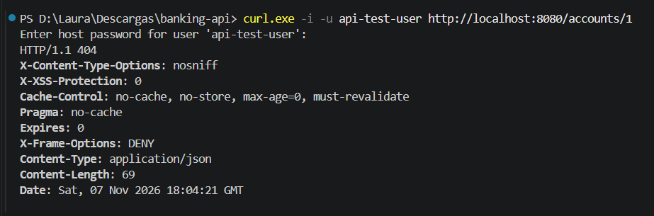

## 4. Create a bank account

The `POST /accounts` endpoint is restricted to users with the `ADMIN` role. The request associates the new account with an existing username.

### 4.1 Prepare the request body

In PowerShell, create the JSON request:

```powershell
$body = @{
    username = "api-test-user"
    accountNumber = "1000000001"
    balance = 100000.00
    currency = "COP"
} | ConvertTo-Json

$body | Set-Content -Path request.json -Encoding utf8
Get-Content request.json
```

### 4.2 Send the request

```powershell
curl.exe -i -u api-test-user -X POST http://localhost:8080/accounts `
    -H "Content-Type: application/json" `
    --data-binary "@request.json"
```

The API should return `201 Created`. Take note of the account ID returned in the response; the following examples use `1`.

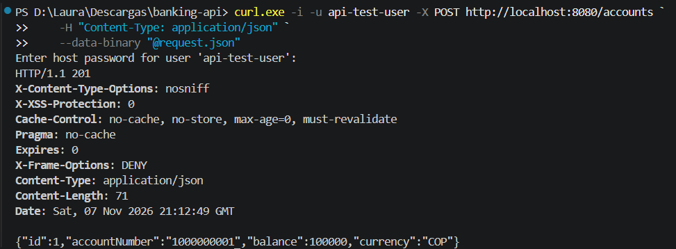

## 5. Retrieve an account

Retrieve the account created in the previous step:

```powershell
curl.exe -i -u api-test-user http://localhost:8080/accounts/1
```

The response should contain the account information, including its balance and currency.

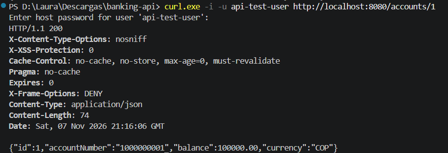

## 6. Verify account ownership isolation

Create a second user with the `USER` role:

```powershell
docker compose exec db psql -U postgres -d banking -c "INSERT INTO users (username, password, role) VALUES ('api-other-user', '$passwordHash', 'USER');"
```

Attempt to retrieve the first user's account using the second user's credentials:

```powershell
curl.exe -i -u api-other-user http://localhost:8080/accounts/1
```

Enter the same test password when prompted. The request should be rejected with `403 Forbidden`, demonstrating that an authenticated user cannot access another user's account.

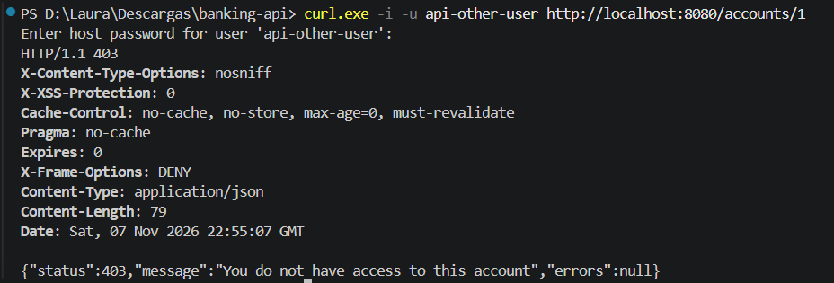

## 7. Deposit money

Prepare a deposit request for 50,000 COP:

```powershell
$body = @{
    amount = 50000
} | ConvertTo-Json

$body | Set-Content -Path deposit.json -Encoding utf8
```

Send the deposit request:

```powershell
curl.exe -i -u api-test-user -X POST http://localhost:8080/accounts/1/deposit `
    -H "Content-Type: application/json" `
    --data-binary "@deposit.json"
```

Retrieve the account again to verify the updated balance:

```powershell
curl.exe -i -u api-test-user http://localhost:8080/accounts/1
```

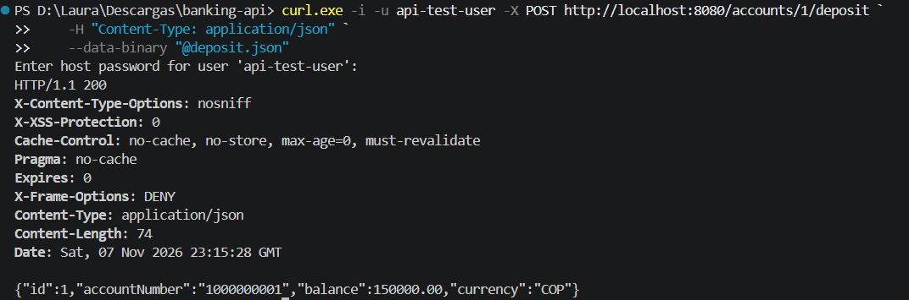
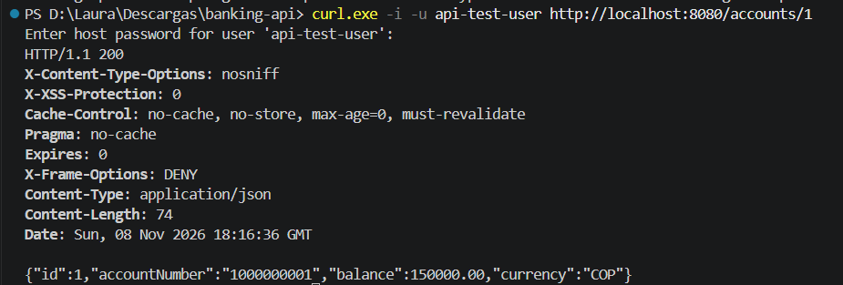

## 8. Withdraw money

Prepare a withdrawal request for 30,000 COP:

```powershell
$body = @{
    amount = 30000
} | ConvertTo-Json

$body | Set-Content -Path withdraw.json -Encoding utf8
```

Send the request:

```powershell
curl.exe -i -u api-test-user -X POST http://localhost:8080/accounts/1/withdraw `
    -H "Content-Type: application/json" `
    --data-binary "@withdraw.json"
```

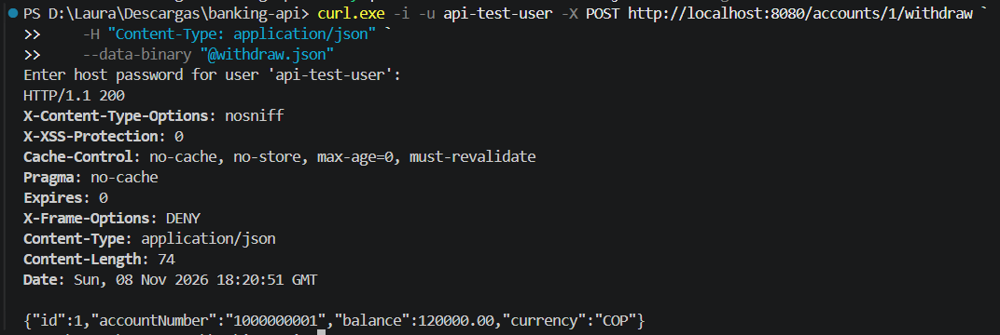

## 9. Reject a withdrawal with insufficient funds

Attempt to withdraw 200,000 COP, which is greater than the expected available balance:

```powershell
$body = @{
    amount = 200000
} | ConvertTo-Json

$body | Set-Content -Path withdraw-insufficient.json -Encoding utf8

curl.exe -i -u api-test-user -X POST http://localhost:8080/accounts/1/withdraw `
    -H "Content-Type: application/json" `
    --data-binary "@withdraw-insufficient.json"
```

The API should reject the operation with `400 Bad Request` and an insufficient-balance error. The account balance must remain unchanged.

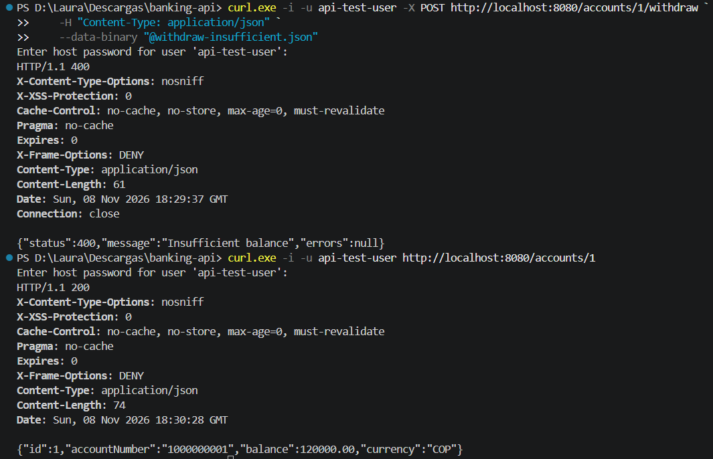

## 10. Transfer money between accounts

### 10.1 Create a destination account

Create a second account for the administrator test user:

```powershell
$body = @{
    username = "api-test-user"
    accountNumber = "1000000002"
    balance = 0
    currency = "COP"
} | ConvertTo-Json

$body | Set-Content -Path request-target.json -Encoding utf8

curl.exe -i -u api-test-user -X POST http://localhost:8080/accounts `
    -H "Content-Type: application/json" `
    --data-binary "@request-target.json"
```

Take note of the destination account ID. The example below assumes it is `2`.

### 10.2 Transfer 40,000 COP

Prepare the transfer request:

```powershell
$body = @{
    sourceAccountId = 1
    targetAccountId = 2
    amount = 40000
} | ConvertTo-Json

$body | Set-Content -Path transfer.json -Encoding utf8
```

Send the transfer:

```powershell
curl.exe -i -u api-test-user -X POST http://localhost:8080/transfers `
    -H "Content-Type: application/json" `
    --data-binary "@transfer.json"
```

The API should process the transfer as one transactional operation, updating both account balances.

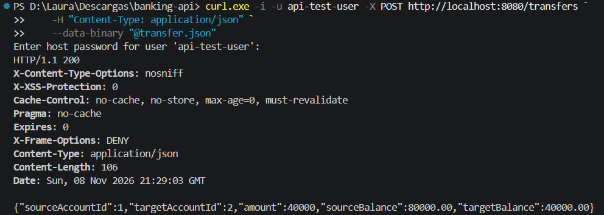

### 10.3 Verify both account balances

Retrieve the source and destination accounts:

```powershell
curl.exe -i -u api-test-user http://localhost:8080/accounts/1

curl.exe -i -u api-test-user http://localhost:8080/accounts/2
```

Assuming the initial balance was 100,000 COP, followed by a 50,000 COP deposit, a 30,000 COP withdrawal, and then a 40,000 COP transfer, the expected balances are:

- Source account: 80,000 COP.
- Destination account: 40,000 COP.

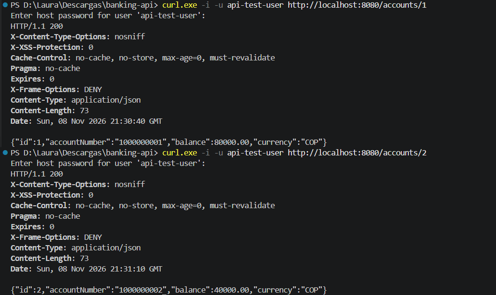

## 11. Reject a transfer with insufficient funds

Attempt to transfer 100,000 COP from the source account, whose expected balance is now 80,000 COP:

```powershell
$body = @{
    sourceAccountId = 1
    targetAccountId = 2
    amount = 100000
} | ConvertTo-Json

$body | Set-Content -Path transfer-insufficient.json -Encoding utf8

curl.exe -i -u api-test-user -X POST http://localhost:8080/transfers `
    -H "Content-Type: application/json" `
    --data-binary "@transfer-insufficient.json"
```

The API should reject the transfer with `400 Bad Request`. Neither account balance should change.

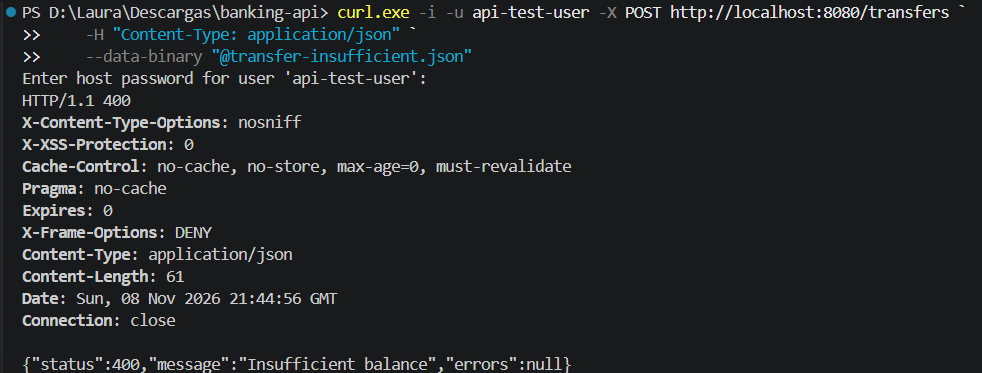

## Notes

- The examples use PowerShell syntax and the Windows `curl.exe` executable.
- When `curl.exe -u username` is used without a password after the username, curl prompts for it instead of storing it in the command history.
- The BCrypt hash is generated locally for this test.
- Account IDs may differ if the database is not empty. Always use the IDs returned by the API.
